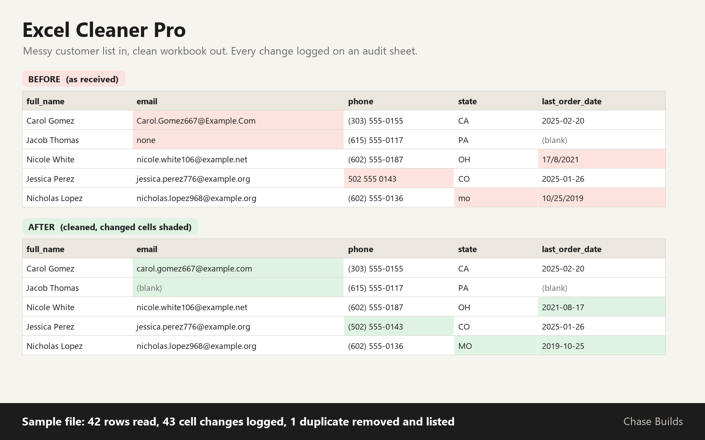

# excel-cleaner-pro

[](https://github.com/chasebuilds/excel-cleaner-pro/actions/workflows/ci.yml)  [](LICENSE)

Turns a messy CSV or Excel file into a clean workbook, and shows every change it made.



## Measured result

On a generated file of 5,297 rows with 6,238 damaged cells (seed 42, default settings, no config file):

| Check | Result |
|---|---:|
| Fixable errors fixed correctly (whitespace, case, phone, date, currency, state, placeholder) | 5,615 of 5,627 |
| Values that cannot be fixed safely, flagged and left as typed | 611 of 611 |
| Exact duplicate rows removed | 150 of 150 |
| Fuzzy duplicate rows listed for a person to review | 122 of 122, plus 5 rows that were not duplicates |
| Rows removed that were not exact duplicates or empty | 0 |
| Input rows not accounted for in `Cleaned` or `Removed` | 0 |
| Control totals balance on every numeric column | yes |
| Speed, 5,297 rows, fuzzy matching on | 1,614 rows per second |

The 12 misses are all surnames typed in ALL CAPS whose capitals cannot be rebuilt by rule
(MACDONALD came back as Macdonald, not MacDonald). Each one is in the `Changes` sheet.

With the opt-in `--fuzzy-remove`, 121 of the 122 fuzzy duplicates were removed, 1 was listed for
review, and no real customer row was removed (also 0 on five other seeds).

These figures describe generated data. Precision and recall per error type, five more seeds, and a
21,000 row speed run are in [BENCHMARK.md](BENCHMARK.md), which is written by
`benchmark/run_benchmark.py`, not by hand. On a client file the checks that carry over are the ones
printed in the workbook itself: row reconciliation, control totals, and the full change log.

## Before and after

Rows from [samples/messy_customers.csv](samples/messy_customers.csv) and what the tool did with them
([samples/cleaned_customers.xlsx](samples/cleaned_customers.xlsx)):

| Row | Before | After | Where it is logged |
|---:|---|---|---|
| 23 | `SOFIA KING` | `Sofia King` | Changes, rule `name_case` |
| 23 | `none` (phone) | empty | Changes, rule `placeholder` |
| 28 | `1-617-555-0116` | `(617) 555-0116` | Changes, rule `phone_format` |
| 39 | `01 November 2020` | `2020-11-01` | Changes, rule `date_iso` |
| 39 | `€5.631,97` | `5631.97` | Changes, rule `number_parse` |
| 14 | `New York` | `NY` | Changes, rule `state_code` |
| 11 | `01/11/2020` | unchanged | Issues, `ambiguous_date`: January 11 or November 1 |
| 27 | `justin.kim718@example` | unchanged | Issues, `invalid_email` |
| 36 | `Mary t. James`, same email as row 30 | row kept | Issues, `possible_duplicate` of row 30, score 98 |
| 31 | identical copy of row 15 | row removed | Removed, `exact duplicate` of row 15 |

## Quick start

Needs Python 3.11 or newer.

```
python -m venv .venv
.venv\Scripts\python -m pip install .
.venv\Scripts\excel-cleaner samples\messy_customers.csv -o samples\cleaned_customers.xlsx
```

On macOS or Linux use `.venv/bin/` in place of `.venv\Scripts\`.

From Python:

```python
from excel_cleaner_pro import clean_file

result = clean_file("customers.xlsx", "customers_cleaned.xlsx")
print(result.rows_in, result.rows_out, len(result.changes), len(result.issues))
```

[examples/use_as_library.py](examples/use_as_library.py) goes further: custom settings, reading
the change log and review list from the result, and cleaning rows already in memory with
`clean_tables`. It runs on the sample file and is checked by the test suite.

## Try it in the browser

A small local web app runs the same library: upload a CSV or XLSX file, see the cleaned rows with
changed cells highlighted (and the same rows as typed), the change log, the review list, the
removed rows, and download the cleaned workbook. It runs on your machine; usage stats are
switched off in `.streamlit/config.toml`.

```
.venv\Scripts\python -m pip install ".[app]"
.venv\Scripts\streamlit run app\streamlit_app.py
```

The page opens at http://localhost:8501. Try it with `samples\messy_customers.csv`.

## How it works

1. **Reads the file and reports what it hides.** CSV (comma, semicolon, tab or pipe) or every sheet
   of an XLSX file. The input file is never written to. Before any cleaning, the reader reports:
   the encoding and delimiter it assumed, title rows above the header, merged cells, hidden sheets,
   rows and columns, and formulas with no stored value. None of these is repaired by guess.
2. **Finds the header row.** The first row that is at least half filled with text. Rows above it go
   to `Removed` with the reason `above header row`. `--header-row N` sets it by hand.
3. **Basic text cleanup.** Trims whitespace, joins split accent characters (Unicode NFC), turns
   placeholder text (`N/A`, `-`, `null`) into empty cells, sets aside empty rows.
4. **Works out each column's type** from your config, then the header, then the values:
   text, id, name, email, phone, date, number, currency or state. A column needs no "date" in its
   header to be read as dates ("Last Order" works): at least 80% of its filled cells must look
   like dates and at least 60% must be real, readable dates. Real Excel date cells count. Values
   with no year (`12/5`), ZIPs (`02134`), invoice numbers (`2024-001`), phones and amounts never
   count, so those columns are not touched.
5. **Applies that type's rule to each cell.** A value is changed only when there is one reading of
   it. Anything else goes to `Issues` and stays as typed.
6. **Duplicates.** Exact duplicate rows are removed. Near matches on the key columns (name plus
   email by default, scored with `rapidfuzz`) are listed in `Issues` with the row they resemble and
   are not removed. `--fuzzy-remove` removes matches scoring 95 or more, and fills blanks in the
   kept row from the removed row, logging each fill.
7. **Checks its own work.** Rows read must equal rows cleaned plus rows removed. Each numeric
   column's total is tracked through removal and must balance. Rules you declare (unique key,
   required column, allowed values, range, pattern) are run and reported on a `Validation` sheet.

What "one reading" means in practice:

- `03/04/2024` could be March 4 or April 3. If other dates in the column can only be month-first
  (`3/15/2024`) and none can only be day-first, it is read month-first and logged under its own rule
  name, `date_iso_inferred_order`, so you can filter for it. If the column gives no proof, or mixed
  proof, the date is flagged and left alone. `--date-order flag` turns the inference off.
- `1,500` is 1500 in a US file and 1.5 in a European one. In a column that mixes both styles it is
  flagged, not converted.
- `Kentuky` is flagged with the suggestion "closest match: Kentucky (KY)". It is not changed.
- Two rows named James Smith with emails `james.smith12@` and `james.smith47@` are different people.
  Differing digits block a fuzzy match.
- A ZIP column holding `2134` has probably lost a leading zero in Excel. It is flagged, not padded,
  because a lost zero and a wrong value look the same.

Settings live in one small TOML file. Write out the defaults, edit, pass it back:

```
.venv\Scripts\excel-cleaner --write-config my_config.toml
.venv\Scripts\excel-cleaner samples\messy_customers.csv -o out.xlsx --config my_config.toml
```

You can switch any rule off, force a column's type, choose the phone format, set the date order,
pick the fuzzy key columns, move the thresholds, and declare validation rules.

## What a client receives

One XLSX file:

| Sheet | What is in it |
|---|---|
| `Read me first` | Plain-language counts, what each sheet is, and how to check the work. |
| `Cleaned` | The cleaned data. The first column, `source_row`, points back to the row in the original file. A workbook with several sheets gets one `Cleaned - <name>` sheet each. |
| `Changes` | One line per edit: sheet, row, column, before, after, rule, note. |
| `Removed` | Every dropped row in full, with the reason, the row it duplicated and the match score. |
| `Issues` | Everything flagged but not changed: invalid emails and phones, ambiguous dates and numbers, unknown states, possible duplicates, merged cells, formulas with no value, IDs that Excel has already damaged, text in the wrong encoding. |
| `Validation` | Only when rules are declared: each rule, pass or fail, and the failing rows. |
| `Data Dictionary` | One line per column: type and how it was decided, filled and missing counts, distinct values, min, max, examples, rules applied. |
| `Summary` | Row reconciliation, control totals per numeric column, changes by rule, flags by type, placeholder text blanked per column, notes about the file, and the run record: input file SHA-256, tool version, encoding assumed, and every setting used. |

## Limits

US-centric (US and Canada phones, US states, dot-decimal default for numbers). Fuzzy matching is
quadratic, so it slows down on large files: 53 seconds for 21,000 rows in the benchmark run, 5
seconds with `--no-fuzzy`. Formulas are read as their last calculated value. Merged cells and
multi-row headers are reported, not restructured. Full list: [LIMITATIONS.md](LIMITATIONS.md).

## Develop

```
.venv\Scripts\python -m pip install -e ".[dev,app]"
.venv\Scripts\python -m pytest
.venv\Scripts\python -m ruff check .
.venv\Scripts\python benchmark\run_benchmark.py
```

## License

MIT. See [LICENSE](LICENSE).
